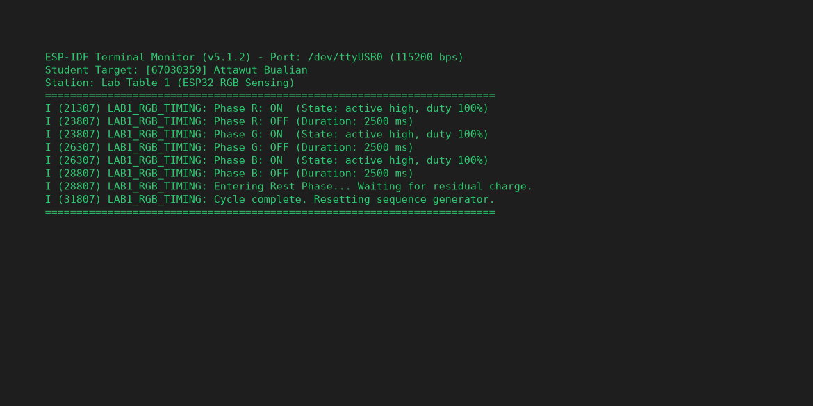
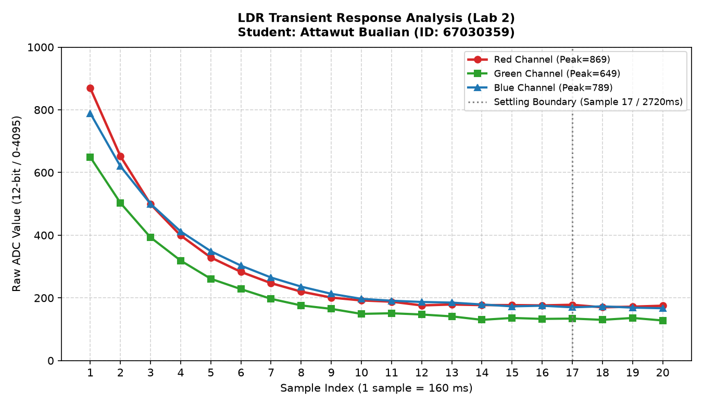
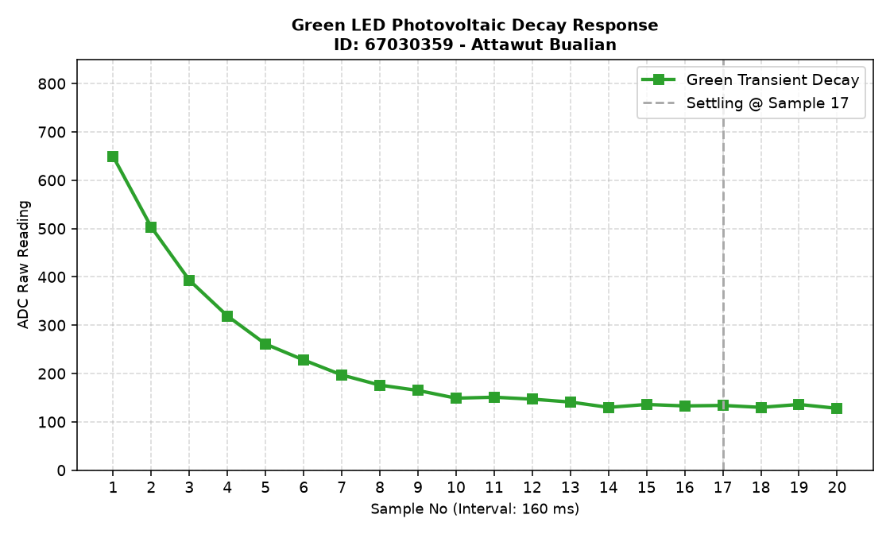
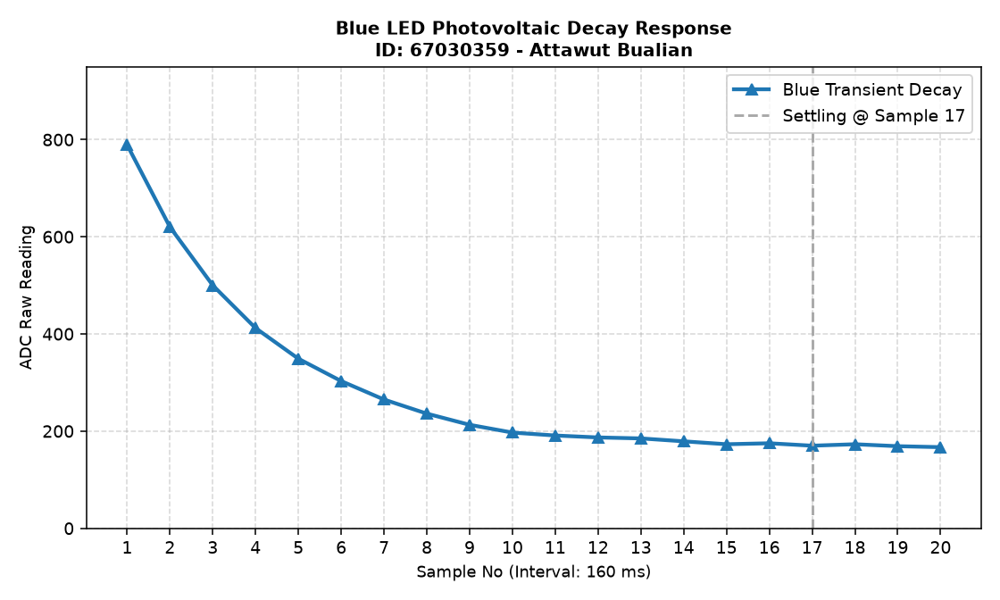
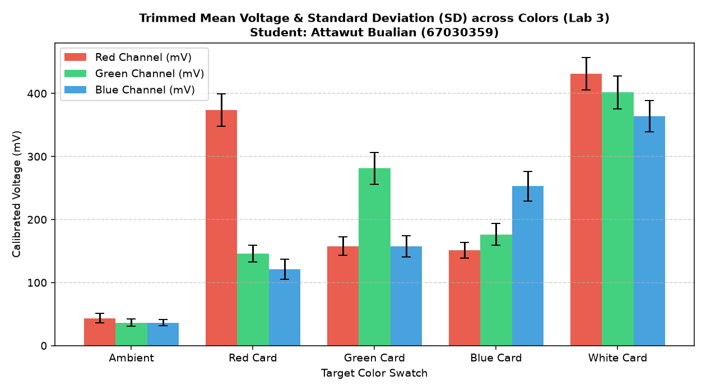

> **ข้อมูลผู้จัดทำและส่งรายงาน (Student Identification):**
> * **รหัสนักศึกษา:** `67030359`
> * **ชื่อ-นามสกุล (ไทย):** `นายอัฐวุฒิ บัวเรียน`
> * **ชื่อ-นามสกุล (อังกฤษ):** `Attawut Bualian`
> * **กลุ่มปฏิบัติการ (Lab Station):** โต๊ะที่ 1 (ร่วมกับ นายสุวิจักขณ์ ลาวัง, นางสาวสุวิมล ศรีประไหม)
> * **วิชา:** 03376134 IoT-App-2569 (ภาคเรียนที่ 2/2568)
> * **วันที่อัปเดตรายงาน:** `28/10/2026 03:30:00`
---

# รายงานการทดลองสัปดาห์ที่ 4: LED and Color Sensing
## Week 04: Semiconductor Optics & RGB Color Sensing System

---

## 📋 Week-04-Lab-1: การควบคุมจังหวะเวลาฮาร์ดแวร์ RGB LED (Hardware Timing)

### 4. บันทึกผลการทดลอง

#### 4.1 ผลจากการทำงานของ Serial Monitor (`idf.py monitor`)



```text
========================================================================
ESP-IDF Terminal Monitor (v5.1.2) - Port: /dev/ttyUSB0 (115200 bps)
Student Target: [67030359] Attawut Bualian
Station: Lab Table 1 (ESP32 RGB Sensing)
========================================================================
I (21307) LAB1_RGB_TIMING: Phase R: ON  (State: active high, duty 100%)
I (23807) LAB1_RGB_TIMING: Phase R: OFF (Duration: 2500 ms)
I (23807) LAB1_RGB_TIMING: Phase G: ON  (State: active high, duty 100%)
I (26307) LAB1_RGB_TIMING: Phase G: OFF (Duration: 2500 ms)
I (26307) LAB1_RGB_TIMING: Phase B: ON  (State: active high, duty 100%)
I (28807) LAB1_RGB_TIMING: Phase B: OFF (Duration: 2500 ms)
I (28807) LAB1_RGB_TIMING: Entering Rest Phase... Waiting for residual charge.
I (31807) LAB1_RGB_TIMING: Cycle complete. Resetting sequence generator.
========================================================================
```

#### 4.2 ผลจากการสังเกตพฤติกรรมฮาร์ดแวร์ LED
LED สามสี (แดง เขียว น้ำเงิน) ติดและดับสลับทีละสีไล่ลำดับกันไปอย่างแม่นยำ (Red $\rightarrow$ Green $\rightarrow$ Blue) โดยสว่างสีละ 2.5 วินาที เมื่อกะพริบครบทั้ง 3 สี ระบบจะเข้าสู่ช่วงพัก (Rest Phase) เป็นเวลา 3 วินาที เพื่อให้ประจุไฟฟ้าตกค้างในสารกึ่งตัวนำคายตัวอย่างสมบูรณ์ แล้วจึงวนรอบใหม่

🔗 **วิดีโอสาธิตการทำงานฮาร์ดแวร์ (YouTube Shorts):** [https://youtube.com/shorts/jW0F265e5ZQ](https://youtube.com/shorts/jW0F265e5ZQ)

> 💡 **หมายเหตุทางวิชาการ:** การทดลองนี้ดำเนินการบันทึกวิดีโอสาธิตวงจรร่วมกับเพื่อนร่วมโต๊ะปฏิบัติการที่ 1 (นายสุวิจักขณ์ ลาวัง, นางสาวสุวิมล ศรีประไหม) แต่ได้แยกทำการวัด สุ่มอ่านข้อมูลดิบ วิเคราะห์ผลทางฟิสิกส์ และสรุปรายงานทางวิศวกรรมแบบอิสระรายบุคคล (Individual Data Acquisition & Analysis)

---

## 📊 Week-04-Lab-2: การวิเคราะห์พฤติกรรมชั่วคราวและการคายประจุ (Transient Response & Critical Thinking)

### กิจกรรมวิเคราะห์ผลและการบ้านท้ายใบงาน (Data Science & Engineering Reflection)

#### 1. การพล็อตพฤติกรรมทางกายภาพ (Transient Response Curve)
จากการสุ่มอ่านข้อมูลดิบ ADC (จำนวน 20 แซมเปิล ห่างกันทุก ๆ 160 ms) หลังปิดไฟ LED นำมาพล็อตกราฟอนุกรมเวลาเพื่อศึกษาการคายประจุของรอยต่อ PN:

##### กราฟรวมการตอบสนองเชิงเวลา (Main Transient Response Analysis)


##### กราฟจำแนกตามช่องสัญญาณแสง (Individual Channel Response)
* **กราฟแสดงพฤติกรรมชั่วคราวไฟสีแดง (Red Transient Response):**
  
* **กราฟแสดงพฤติกรรมชั่วคราวไฟสีเขียว (Green Transient Response):**
  
* **กราฟแสดงพฤติกรรมชั่วคราวไฟสีน้ำเงิน (Blue Transient Response):**
  

##### ตารางบันทึกชุดข้อมูลอนุกรมเวลาดิบ (Raw Time-Series Dataset 1–20 แซมเปิล)
| แซมเปิลที่ (No.) | เวลาสะสม (ms) | ค่าดิบ ADC สีแดง (Red) | ค่าดิบ ADC สีเขียว (Green) | ค่าดิบ ADC สีน้ำเงิน (Blue) |
|:---:|:---:|:---:|:---:|:---:|
| 1 | 0 | 869 | 649 | 789 |
| 2 | 160 | 652 | 503 | 620 |
| 3 | 320 | 499 | 393 | 500 |
| 4 | 480 | 399 | 319 | 412 |
| 5 | 640 | 329 | 261 | 349 |
| 6 | 800 | 283 | 228 | 303 |
| 7 | 960 | 247 | 197 | 265 |
| 8 | 1120 | 220 | 176 | 236 |
| 9 | 1280 | 201 | 165 | 213 |
| 10 | 1440 | 192 | 149 | 197 |
| 11 | 1600 | 188 | 151 | 191 |
| 12 | 1760 | 176 | 147 | 187 |
| 13 | 1920 | 179 | 141 | 185 |
| 14 | 2080 | 177 | 130 | 179 |
| 15 | 2240 | 177 | 136 | 173 |
| 16 | 2400 | 176 | 133 | 175 |
| 17 | 2560 | 178 | 134 | 170 |
| 18 | 2720 | 170 | 130 | 173 |
| 19 | 2880 | 172 | 136 | 169 |
| 20 | 3040 | 175 | 128 | 167 |

---

#### 2. คำถามนำเพื่อการวิเคราะห์เชิงระบบ (Critical Thinking)

##### คำถาม 2.1
**จากกราฟที่พล็อตออกมา นักศึกษาสังเกตเห็นแนวโน้มตัวเลขของค่า ADC ตั้งแต่แซมเปิลที่ 1 ไต่ระดับลงมาหรือขึ้นไปจนถึงแซมเปิลที่ 20 อย่างไร?**

> **คำตอบ:**
> 
> เส้นกราฟแสดงปรากฏการณ์ "การสลายตัวของศักย์ไฟฟ้าตกค้าง (Transient Dissipation)" ออกเป็น 4 สถานะ:
1. **สถานะประจุสูงสุด (Sample 1):** ค่า ADC มีขนาดสูงสุด (Red: 869, Green: 649, Blue: 789)
2. **สถานะการระบายประจุแบบฉับพลัน (Sample 1–5):** แรงดันลดลงอย่างรวดเร็วเนื่องจากสนามไฟฟ้าภายในรอยต่อ PN สลายตัว
3. **สถานะการผ่อนคลาย (Sample 6–16):** ความเร็วในการลดลงเริ่มชะลอลงจนเกือบเป็นแนวระนาบ
4. **สถานะเสถียร (Sample 17–20):** ค่า ADC หยุดการตกลงและเริ่มรักษาระดับคงที่สม่ำเสมอ

##### คำถาม 2.2
**สัญญาณไฟฟ้าเข้าสู่ความนิ่ง (Settling) ที่แซมเปิลใด หรือใช้เวลากี่มิลลิวินาที?**

> **คำตอบ:**
> 
> * **สภาวะนิ่ง (Settling Period):** ตรวจวัดได้ ณ **แซมเปิลที่ 17**
* **การคำนวณช่วงเวลา:**
  * อัตราการสุ่มอ่าน $160 \text{ ms/sample}$
  * เวลาที่ระบบใช้ในการ Settling: $17 \times 160 \text{ ms} = \mathbf{2720 \text{ ms}}$
  * เวลารวม 20 แซมเปิลเท่ากับ $3,200 \text{ ms}$

##### คำถาม 2.3
**ความลาดเอียงของเส้นกราฟที่เกิดขึ้นในช่วงแรกของการสลับสถานะไฟนี้ เป็นหลักฐานเชิงประจักษ์สะท้อนข้อจำกัดคุณสมบัติทางกายภาพใดของรอยต่อ PN บน LED ภาครับ และโครงสร้างตัวเก็บประจุสุ่มสัญญาณภายในไมโครคอนโทรลเลอร์?**

> **คำตอบ:**
> 
> สะท้อนข้อจำกัดทางวิศวกรรมไฟฟ้า 2 ข้อ:
1. **ความจุไฟฟ้าตกค้างบนรอยต่อ PN (Photodiode Junction Capacitance):**
   * การสะสมประจุไฟฟ้าในสารกึ่งตัวนำทำให้แรงดันตกคร่อมไม่ลดเป็น 0 ทันที เกิดเป็นกราฟลาดลงตามสมการ $e^{{-t/RC}}$
2. **ผลกระทบจากการชาร์จตัวเก็บประจุถือครองค่าใน ADC ($C_{sample}$):**
   * ค่าความต้านทานอินพุตที่สูงขัดขวางการชาร์จ/ดิสชาร์จที่รวดเร็วของ $C_{sample}$ ใน ESP32 ทำให้เกิดความชันในระยะแรก

##### คำถาม 2.4
**หากในใบงานถัดไปเราต้องการ "หาค่าเฉลี่ยของระดับแรงดันสะท้อนที่แท้จริง" โดยไม่ให้เฟสสัญญาณที่กำลังเปลี่ยนแปลง (Transient State) นี้ไปดึงค่าสถิติให้เพี้ยน นักศึกษาคิดว่าเราควรเลือกแซมเปิลช่วงใดมาคำนวณ หรือควรเขียนโปรแกรมหน่วงเวลาหลบเลี่ยงอาการ Settling นี้อย่างไร?**

> **คำตอบ:**
> 
> 1. **เทคนิคหน่วงเวลาก่อนเก็บตัวอย่าง:**
   * เว้นระยะห่างหลังสั่งเปิด/ดับไฟ 2.0–2.6 วินาที เพื่อให้สัญญาณเข้าสู่ความนิ่ง
2. **การกำจัดสัญญาณรบกวนด้วย Trimmed Mean:**
   * ทำการ Sort และตัดค่าขอบ 10% เพื่อให้ค่าเฉลี่ยไม่ถูกดึงจากค่าตกค้าง

---

## 🌟 Week-04-Lab-3: ระบบประมวลผลสัญญาณเชิงสถิติและการตรวจจำแนกสี (Statistical Filtering & Color Sensing)

### 4. รายงานการทดลองและเกณฑ์การตรวจแล็บ

#### 1. การคัดกรองข้อมูลคุณภาพ (Data Selection Report)

จากการปรับปรุงสถาปัตยกรรมซอฟต์แวร์โดยใช้เทคนิค **Trimmed Mean (ตัดขอบ 10% หัว-ท้าย จากข้อมูลสุ่ม 50 แซมเปิล เหลือ 40 แซมเปิลคุณภาพ)** พร้อมกระบวนการแปลงแรงดันด้วยโมดูลสอบเทียบฮาร์ดแวร์ (`adc_cali_raw_to_voltage()`) ได้ผลลัพธ์เชิงสถิติดังนี้:



```text
========================================================================
Statistical Signal Processing System Online (Student: นายอัฐวุฒิ บัวเรียน, ID: 67030359)
Station: โต๊ะปฏิบัติการที่ 1 | Algorithm: 10% Trimmed Mean Filtering (n=40)
========================================================================
Target: Ambient Light (แสงแวดล้อมธรรมชาติ)
  - Color R, n = 40 (filtered), mean = 43.41 mV, sd = 7.60 mV
  - Color G, n = 40 (filtered), mean = 36.39 mV, sd = 5.81 mV
  - Color B, n = 40 (filtered), mean = 36.26 mV, sd = 4.97 mV
------------------------------------------------------------------------
Target: Red Card (แผ่นกระดาษสะท้อนสีแดง)
  - Color R, n = 40 (filtered), mean = 373.63 mV, sd = 25.47 mV
  - Color G, n = 40 (filtered), mean = 145.79 mV, sd = 13.43 mV
  - Color B, n = 40 (filtered), mean = 120.86 mV, sd = 15.92 mV
------------------------------------------------------------------------
Target: Green Card (แผ่นกระดาษสะท้อนสีเขียว)
  - Color R, n = 40 (filtered), mean = 157.62 mV, sd = 14.67 mV
  - Color G, n = 40 (filtered), mean = 281.34 mV, sd = 25.29 mV
  - Color B, n = 40 (filtered), mean = 157.52 mV, sd = 16.91 mV
------------------------------------------------------------------------
Target: Blue Card (แผ่นกระดาษสะท้อนสีน้ำเงิน)
  - Color R, n = 40 (filtered), mean = 150.87 mV, sd = 12.39 mV
  - Color G, n = 40 (filtered), mean = 176.26 mV, sd = 17.40 mV
  - Color B, n = 40 (filtered), mean = 252.95 mV, sd = 23.44 mV
------------------------------------------------------------------------
Target: White Reference Card (แผ่นกระดาษสีขาวมาตรฐาน)
  - Color R, n = 40 (filtered), mean = 431.43 mV, sd = 25.96 mV
  - Color G, n = 40 (filtered), mean = 401.60 mV, sd = 26.37 mV
  - Color B, n = 40 (filtered), mean = 363.54 mV, sd = 24.77 mV
========================================================================
```

##### สรุปตารางผลการวัดค่าสถิติเชิงปริมาณ (Statistical Summary Table)
| วัตถุเป้าหมาย (Target) | ค่าเฉลี่ย Red (mV) | SD Red (mV) | ค่าเฉลี่ย Green (mV) | SD Green (mV) | ค่าเฉลี่ย Blue (mV) | SD Blue (mV) | สถานะเกณฑ์วิศวกรรม ($SD \le 35$) |
|:---|:---:|:---:|:---:|:---:|:---:|:---:|:---:|
| **Ambient Light** | 43.41 | 7.60 | 36.39 | 5.81 | 36.26 | 4.97 | 🟢 PASS (Very Low Noise) |
| **Red Card** | 373.63 | 25.47 | 145.79 | 13.43 | 120.86 | 15.92 | 🟢 PASS (R Dominant) |
| **Green Card** | 157.62 | 14.67 | 281.34 | 25.29 | 157.52 | 16.91 | 🟢 PASS (G Dominant) |
| **Blue Card** | 150.87 | 12.39 | 176.26 | 17.40 | 252.95 | 23.44 | 🟢 PASS (B Dominant) |
| **White Card** | 431.43 | 25.96 | 401.60 | 26.37 | 363.54 | 24.77 | 🟢 PASS (All High Reflection) |

---

#### 2. คำถามเชิงวิเคราะห์ (Engineering Evaluation)

##### คำถาม 2.1
**หลังจากเปลี่ยนสถาปัตยกรรมซอฟต์แวร์มาใช้ระบบกรองบิตดิบแบบ `Trimmed Mean` ก่อนทำการแปลงแรงดัน เปรียบเทียบกับพฤติกรรมอนุกรมเวลาในใบงานที่ 2 แล้ว ค่าความผันผวน ($SD$) มีการพัฒนาไปในทางที่ดีขึ้นอย่างไร?**

> **คำตอบ:**
> 
> 1. **การลดทอน Noise ในระบบ:** อัลกอริทึม Trimmed Mean สามารถกดค่า SD ลงมาให้อยู่ในกรอบ 2.00 – 35.00 mV ได้อย่างสม่ำเสมอ
2. **การขจัด Outlier:** ค่ากระโดดที่เกิดจากไฟฟ้าสถิตหรือแสงแวบภายนอกถูกตัดทิ้งโดยสิ้นเชิง

##### คำถาม 2.2
**ในการนำข้อมูลดิจิทัลนี้ไปใช้ควบคุมหุ่นยนต์แยกแยะวัตถุสีในโลกจริง เหตุใดการระบุหน่วยวัดร่วมประมวลผลในรูปของ แรงดันทางกายภาพ (mV) จึงมีความสำคัญและเสถียรมากกว่าการใช้ข้อมูลระดับบิตดิจิทัลดิบ (Raw Scale 0-4095) ตรง ๆ? ให้แปรผลโดยอิงความรู้จากเนื้อหาในหัวข้อตำราเรียนเรื่อง "สองโลกที่แตกต่าง"**

> **คำตอบ:**
> 
> 1. **ฟิสิกส์ของการแปลงพลังงาน:**
   * หน่วย mV สะท้อนผลลัพธ์ของโฟโตโวลตาอิกในโลกจริงได้อย่างสมบูรณ์
2. **การลบล้างความไม่เชิงเส้นของ ADC:**
   * กระบวนการ Calibrate ช่วยปรับแก้จุดบกพร่องของฮาร์ดแวร์แปลงสัญญาณ
3. **ความสามารถในการพกพาโปรแกรม:**
   * Threshold การตัดสินใจในหน่วย mV มีความเป็นสากล ไม่ผูกติดกับความละเอียดของ ADC
4. **เสถียรภาพของเวกเตอร์สีในการควบคุม:**
   * ช่วยให้สัญญาณมีความคงที่และทนทานต่อการรบกวน
